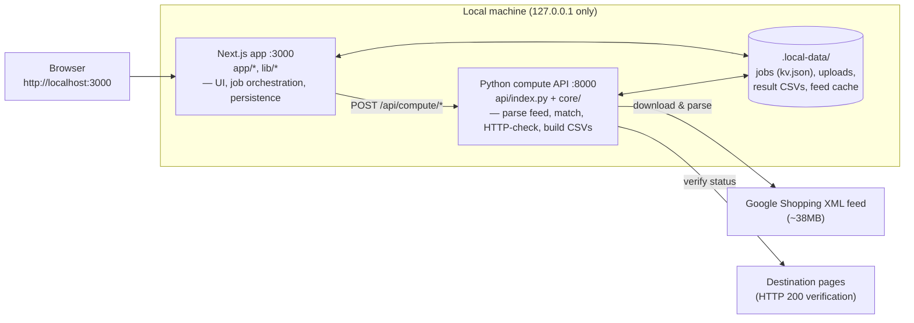

# Automated 404 URL Recovery for VTEX

Internal tool that maps broken (404) URLs to active pages by cross-referencing legacy URLs against a live Google Shopping XML feed, and generates VTEX-ready `301` redirect files. Built to reduce Google Search Console crawl errors and recover lost SEO equity after catalog/URL restructures.

Runs **only on the local machine** — no cloud services, no login. Everything is stored on local disk.

## Contents

- [Architecture](#architecture)
- [Tech stack](#tech-stack)
- [Matching engine](#matching-engine)
- [Project layout](#project-layout)
- [Installation](#installation)
- [Usage](#usage)
- [Testing](#testing)
- [Continuous integration](#continuous-integration)
- [Known limitations](#known-limitations)

## Architecture



- **`api/index.py` (compute)** holds no job state: every request carries the current `JobState` as JSON and every response returns the updated one. It parses the feed (cached in memory and on disk, `core/feed_cache.py`), fuzzy-matches a batch of rows, checks a batch of destination URLs and builds the final CSVs.
- **`app/` + `lib/` (orchestrator)** is what the browser talks to. It stores job records and files on disk (`lib/localStore.ts`) and drives the compute API forward one batch at a time via `POST /backend/jobs/:id/advance`, called repeatedly by the job page — which is what powers the progress bar.
- **`scripts/start-local.mjs`** starts both processes with one command, bound to `127.0.0.1` so the tool is not reachable from the network.

The only network access is to the product feed and to the store pages being verified.

## Tech stack

| Layer | Technology | Purpose |
|---|---|---|
| Frontend | Next.js 16 (App Router), React 19, TypeScript | Upload form, job progress page, run history |
| Frontend styling | Hand-written CSS (design tokens in `app/globals.css`) | No CSS framework dependency |
| Orchestration | Next.js Route Handlers (`app/backend/*`) | Job lifecycle, calls into the compute API |
| Compute | Python 3.12, FastAPI + uvicorn | Matching / HTTP-check / export steps |
| Matching | `rapidfuzz`, `pandas`, custom rules (`core/`) | Legacy-category / exact / fuzzy slug matching |
| Storage | Local disk (`lib/localStore.ts`, `core/feed_cache.py`) | Jobs, uploads, result CSVs, feed cache |
| Testing | `pytest` (Python), `next build` (TypeScript type-checking) | See [Testing](#testing) |
| CI | GitHub Actions (`.github/workflows/ci.yml`) | Runs both test suites on every push/PR |

## Matching engine

Rules are applied in order to each 404 URL:

1. **Legacy Linx URL → equivalent category.** URLs with a Linx product id (`...-p12345`) belong to products that no longer exist. The product name is taken from the URL (the `-p12345` suffix is dropped), the most similar active product in the feed is found by word-set similarity (`rapidfuzz.fuzz.token_set_ratio`, order-insensitive), and the redirect points to **that product's category page**. The category path comes from the feed's `g:product_type` hierarchy, slugified level by level: `Moda e Acessórios - Calçados - Tênis` → `/moda-e-acessorios/calcados/tenis`. Match type `Legacy_Category_<score>%`. When no product reaches the threshold, the row is `Legacy_No_Category` and gets **no redirect** (it only appears in the review file). Nothing redirects to a generic landing page such as `/superoferta`.
2. **Exact slug match**: slugs extracted from 404 URLs are matched 1:1 against active slugs from the feed.
3. **Fuzzy match**: Levenshtein-based similarity (`rapidfuzz`) against active slugs, default `90%` threshold. Candidates whose slugs disagree on a numeric token (model number, screen size, storage, etc.) are rejected even when the text is otherwise near-identical — `smart-tv-lg-50-polegadas` never matches `smart-tv-lg-55-polegadas`. (This guard is not applied to legacy category inference, since different variants share a category.)

Applied to every match:

- **Minimum accuracy floor**: no match — of any type — reaches the final export below `match_score = 80`. Enforced server-side (`core/config.MIN_MATCH_SCORE`); the CLI `--threshold` flag and the web UI's threshold field cannot lower it.
- **Same-URL loop prevention**: a match where `from == to` is flagged `Same_URL_Ignored` and excluded, avoiding `ERR_TOO_MANY_REDIRECTS`.
- **HTTP 200 verification**: destination URLs (product and category pages) are checked concurrently; only verified `200` destinations reach the final VTEX import file.
- **Output**: `redirects.csv` (VTEX import format — `from;to;type;endDate`) with only verified matches and one rule per `from`, plus `review.csv` with full diagnostics (`match_type`, `match_score`, `status_code`) for SEO audit.

## Project layout

```text
core/               Matching engine — plain Python, no web/CLI concerns
├── config.py           RecoveryConfig, MIN_MATCH_SCORE, local data dir
├── feed.py              feed download/parsing (slug -> URL, slug -> category)
├── feed_cache.py         in-memory + on-disk feed cache with TTL
├── category.py            product_type -> category path, legacy slug, CategoryIndex
├── text_utils.py           encoding fixes (nested percent-encoding, etc.)
├── matching.py              legacy detection / same-URL / numeric variant guard
├── http_check.py             HTTP 200 verification
├── export.py                  CSV output
└── pipeline.py                 orchestration: one-shot + resumable/batched

api/index.py         Local FastAPI compute API (see Architecture)
cli.py              Standalone one-shot CLI entrypoint over core/
scripts/start-local.mjs  Starts compute API + Next.js together
app/                Next.js app: upload / job / history pages
└── backend/            Route handlers: job lifecycle, orchestration, downloads

lib/                Next.js backend support
├── localStore.ts       File-based storage (blobs + tiny KV)
├── blob.ts               Job files (uploads, result CSVs)
├── kv.ts                   Job records + history index
└── pythonCompute.ts          Client for api/index.py

tests/              pytest suite covering core/ and api/
```

## Installation

Requires Python **3.12** and Node.js **22+**.

```bash
python -m venv .venv
# Windows: .venv\Scripts\activate   |   Linux/Mac: source .venv/bin/activate
pip install -r requirements.txt

npm install
```

## Usage

### Web UI (primary interface)

```bash
npm run local        # builds, then starts both servers
# or, while changing the code:
npm run local:dev    # next dev (hot reload) + compute API
```

Open <http://localhost:3000>. Ctrl+C stops both servers.

The launcher uses the Python from `.venv/` (or `venv/`) when present, otherwise `python` from `PATH`; override with the `PYTHON` environment variable. Ports: `WEB_PORT` (default 3000) and `PYTHON_PORT` (default 8000).

Optional settings (see `.env.example`):

- `LOCAL_DATA_DIR` — where jobs, uploads, result CSVs and the feed cache live (default `./.local-data`). Consider a folder outside OneDrive sync.
- `FEED_CACHE_TTL_SECONDS` — how long the downloaded feed is reused (default 6h). The first run downloads it (~10–15s); later runs reuse it, even across restarts.

The Python compute API runs **without** `--reload` (see `KNOWN_ISSUES.md` #2): after editing `core/` or `api/`, restart the launcher.

### CLI (one-shot, no web UI)

```bash
python cli.py --input 404-gsc/Tabela.csv --output-dir output
```

Run `python cli.py --help` for the full flag list (`--xml-url`, `--threshold`, `--no-http-check`, `--max-workers`). Writes `output/redirects.csv` and `output/redirects_review.csv`. Uses the same feed cache as the web UI.

## Testing

- **Python** (`core/` matching logic + `api/index.py` compute endpoints): `pytest tests/`.
- **Web** (`app/`, `lib/`): `npm run build` — Next.js type-checks the whole app as part of the production build.

## Continuous integration

`.github/workflows/ci.yml` runs both suites above — `pytest` on Python 3.12 and the Next.js build on Node 22 — on every push/PR to `main`/`master`.

## Known limitations

Tracked in detail in `KNOWN_ISSUES.md`.

- Legacy category inference relies on the feed still carrying similar products; very old or unique products may end up as `Legacy_No_Category` (no redirect).
- When two equally similar products sit in different categories, the first one found wins.

## Notes

- `AGENTS.md` / `CLAUDE.md` at the repo root are auto-generated by `next dev` (Next.js 16 writes agent-facing notes about its own breaking changes) — regenerated on every dev run, safe to ignore or commit.
- This is an internal tool (`"license": "UNLICENSED"` in `package.json`) built for VTEX store administrators and technical SEO specialists at Bemol — not published or licensed for external use.
